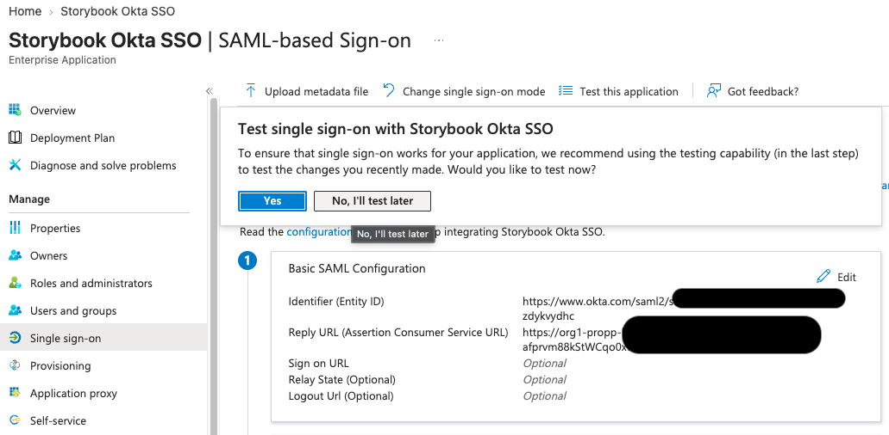
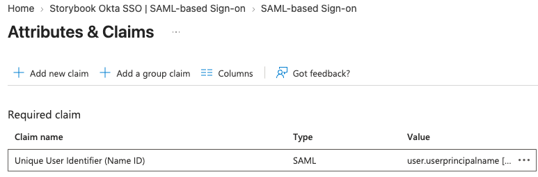
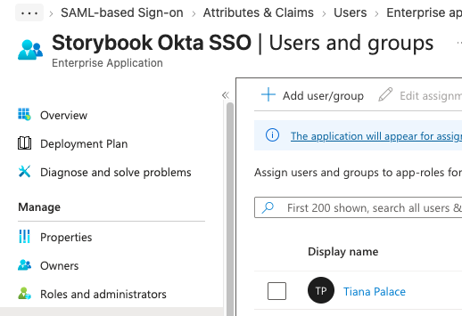
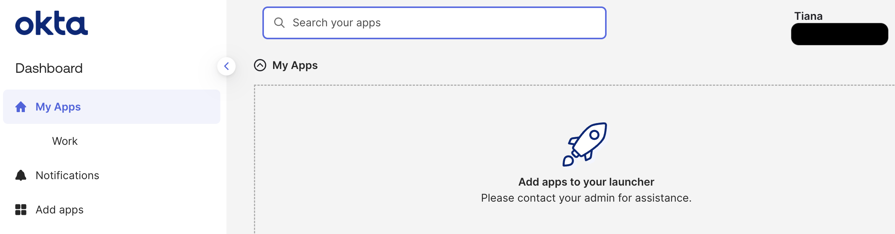
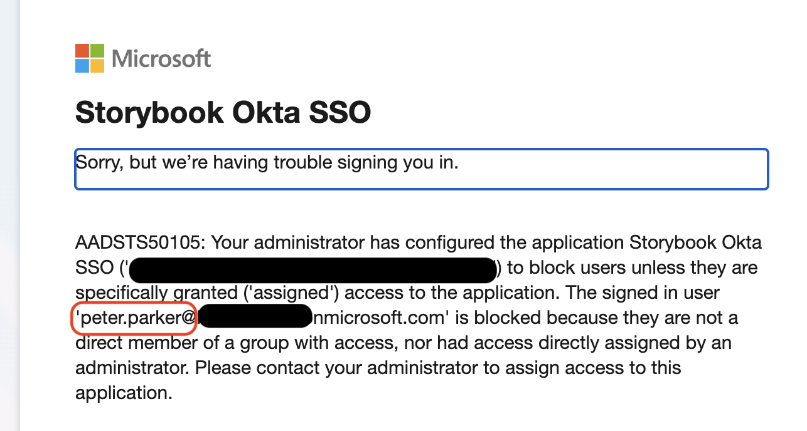

# Storybook Studios SAML SSO Lab

## Overview

Storybook Studios needed employees to access Okta using their Microsoft Entra identities.

I configured Entra ID as the identity provider and Okta as the service provider using SAML 2.0. I tested successful access for an assigned employee and blocked access for an unassigned employee.

## Skills Practiced

## Business Scenario

Tiana Palace works in Finance and is approved to use the Entra to Okta SSO connection.

Peter Parker works in Creative and has not been approved for that connection.

## Configuration

| Component | Configuration |
|---|---|
| Entra enterprise application | Storybook Okta SSO |
| Okta identity provider | Storybook Entra ID |
| Authentication protocol | SAML 2.0 |
| Assertion verification | Entra signing certificate uploaded to Okta |
| Entra Identifier | Okta Audience URI |
| Entra Reply URL | Okta Assertion Consumer Service URL |
| NameID source | user.userprincipalname |
| Okta matching attribute | Okta Username |
| Account linking | Automatic |
| Unmatched users | Redirect to Okta |
| Entra assignment required | Yes |

I manually created Tiana’s Okta account with a username matching her full Entra username. JIT account creation was disabled.

## Test Results

| Test | Expected Result | Actual Result |
|---|---|---|
| Tiana opens the Entra application access URL | Successful SSO to Okta | Passed |
| Peter opens the same URL without an assignment | Entra blocks access | Passed with error 50105 |

## Troubleshooting

The certificate download appeared unavailable on the main SAML page.

I inspected the SAML Signing Certificate panel, identified the active certificate, and downloaded its PEM version from the certificate menu.

## What I Learned

SAML federation lets Okta trust authentication performed by Entra.

The signing certificate allows Okta to verify the signature on the SAML assertion.

NameID mapping and username matching connect the authenticated Entra identity to the correct Okta account.

Application assignments control who can use the Entra SSO connection. Testing an unassigned employee confirmed that this restriction worked.

## Evidence

### SAML Configuration

### Identity Mapping

### Approved Employee

### Successful SSO

### Unassigned Employee Blocked

## Scope

This lab used fictional employees in practice tenants.

Testing started from the Entra application access URL. Okta sign in routing rules were not configured.

Tiana’s Okta account was created manually. SCIM provisioning, automated account removal, and OIDC were outside this exercise.

Peter’s blocked result applies to this Entra SSO connection. It does not establish whether he could use another Okta sign in method.
